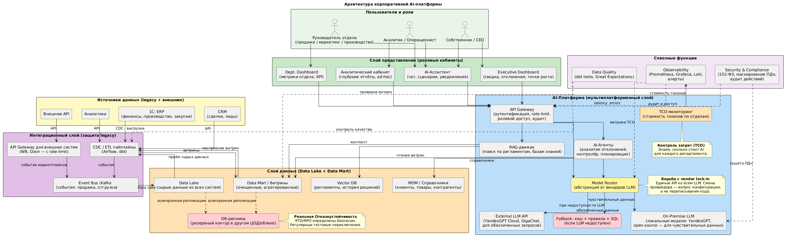

**Устройство корпоративной платформы управления бизнесом**

**Источники данных и корпоративные системы**

К платформе были подключены **четыре типа источников**, разделённые по характеру данных и способу интеграции:

**Операционные системы (синхронные выгрузки):**

- **ERP-система заказчика** — финансовые данные, закупки, себестоимость, товарные остатки. Интеграция через API + периодические пакетные выгрузки по расписанию.
- **Корпоративная CRM** — данные о клиентах, сделках, лидах, истории взаимодействий. Интеграция через REST API с OAuth 2.0.

**Внешние источники:**

- **Внешние API** (аналитические сервисы, справочники, информационные сервисы) — через внешний API Gateway с rate-limiting и кэшированием для защиты от перегрузок.

**Внутренние сервисы:**

- Логи пользовательских событий, метрики собственных приложений, данные аналитических систем.

Все источники проходили через **единый интеграционный слой** (Kafka как шина событий + CDC-пайплайны), что позволило защитить продуктивные системы от перегрузки аналитическими запросами и обеспечить согласованность данных.

**Как обновлялись и проверялись данные**

**Обновление данных — двухуровневая архитектура:**

- **Batch-обновление (ночные пайплайны):** Apache Airflow оркестрировал dbt-трансформации по слоям Raw → ODS → DM → витрины. Пайплайны запускались по расписанию с зависимостями между слоями.

**Real-time события:** Kafka принимал CDC-события (через Debezium для баз данных, через коннекторы для API) и передавал их в стриминговые пайплайны Spark для near-real-time обновления витрин и фичей.

**Проверка качества данных (Data Quality):**

- **dbt tests** на уровне трансформаций: уникальность ключей, not_null для обязательных полей, referential integrity между слоями, доменные проверки.
- **Great Expectations** для сложных бизнес-проверок: согласованность сумм между слоями, свежесть данных (freshness SLA), распределительные тесты (не должно быть аномальных всплесков).
- **Линейдж (lineage):** автоматическая трассировка зависимостей между источниками, трансформациями и витринами — для быстрого определения каскадных эффектов при сбоях.

При падении любого теста пайплайн автоматически помечался как «нездоровый», и данные не попадали в продуктивные витрины — срабатывал алерт в Alertmanager.

**Кабинеты, интерфейсы и дашборды**

**Ролевые витрины** были разделены на три типа в зависимости от потребностей пользователя:

- **Executive-дашборды** (для руководителей): сводные KPI, отклонения от плана, тренды, ключевые риски. Визуализация через BI-инструмент (Yandex DataLens / Apache Superset) с drill-down возможностями.
- **Аналитические кабинеты** (для аналитиков): детализированные срезы данных, ad-hoc редактор SQL-запросов, возможность экспорта. Прямой доступ к витринам уровня DM.
- **Операционные интерфейсы** (для менеджеров и операционистов): задачи и уведомления, интегрированные с корпоративной системой задач; формы для ручного ввода корректировок.

**AI-ассистент** был реализован как отдельный чат-интерфейс с доступом к витринам через Text2SQL и к регламентной базе знаний через RAG (векторный поиск по Qdrant).

**Дашборды наблюдаемости** для технической команды: Grafana с метриками платформы (latency, error rate, token throughput, queue depth), алерты в Alertmanager.

**Роли и уровни доступа**

Ролевая модель была построена на базе **RBAC с атрибутным расширением (ABAC)**:

| **Роль**                              | **Доступ к данным**                                                                                   | **Действия**                                |
| ------------------------------------- | ----------------------------------------------------------------------------------------------------- | ------------------------------------------- |
| **Руководитель (CEO / Head of Dept)** | Сводные метрики своего подразделения и выше. Не видит детализацию до уровня конкретных клиентов (ПДн) | Просмотр дашбордов, запрос отчётов          |
| **Аналитик**                          | Детализированные данные в рамках своей бизнес-области                                                 | Ad-hoc запросы, экспорт, построение отчётов |
| **Операционист / Менеджер**           | Данные только по своим задачам и контрагентам                                                         | Исполнение задач, обновление статусов       |
| **Data Engineer / ML Engineer**       | Технические метаданные, доступ к пайплайнам и моделям                                                 | Разработка, мониторинг, отладка             |
| **Администратор**                     | Полные технические права, но без доступа к бизнес-данным пользователей                                | Управление инфраструктурой, доступами       |

**Разграничение данных** реализовано на уровне SQL-витрин через фильтры по tenant_id / department_id и через API Gateway, который инжектировал контекст пользователя в каждый запрос. Все действия логировались для аудита.

**Что было разработано с нуля, а что собрано на готовых решениях**

**Использованы готовые open-source и облачные решения:**

| **Компонент**           | **Решение**                    | **Почему выбрано**                                                  |
| ----------------------- | ------------------------------ | ------------------------------------------------------------------- |
| MPP-хранилище           | Greenplum                      | Зрелость, производительность на аналитических запросах, открытое ПО |
| Шина событий            | Apache Kafka                   | Стандарт для high-throughput event streaming                        |
| Оркестрация пайплайнов  | Apache Airflow + dbt           | Индустриальный стандарт ETL/ELT                                     |
| Векторная БД            | Qdrant                         | Производительность, простой API, open-source                        |
| LLM Serving             | vLLM, Triton Inference Server  | Best-in-class для LLM и классических ML-моделей                     |
| Оркестрация контейнеров | Kubernetes                     | Стандарт для production-развёртывания                               |
| Мониторинг              | Prometheus + Grafana + Loki    | Стандарт наблюдаемости                                              |
| Data Quality            | Great Expectations + dbt tests | Зрелые инструменты с хорошей интеграцией                            |
| Автоскейлинг            | KEDA                           | Автоскейлинг по кастомным метрикам (LLM-специфичные)                |

**Разработано с нуля (кастомная часть):**

1. **Интеграционный слой (Event Sourcing + CQRS):** собственные коннекторы к legacy-системам заказчика, паттерны компенсации сбоев (Saga), кастомные обработчики событий.
2. **Feature Store-обвязка:** собственные механизмы point-in-time корректности, синхронизация между offline (Greenplum) и online (Valkey/Redis) хранилищами.
3. **Model Router:** собственная абстракция над LLM-провайдерами (vLLM, внешние API) с fallback-логикой, защитой от каскадных сбоев (Circuit Breaker) и мониторингом TCO.
4. **LLM Observability-модуль:** кастомные метрики (KV cache utilization, token throughput, request queue) и алерты, специфичные для LLM-инференса.
5. **Data Governance-процессы:** собственные стандарты именования, шаблоны dbt-моделей, процессы ревью, документация lineage.
6. **Бизнес-логика скоринга и AI-агентов:** специфичные для заказчика модели, промпты, цепочки рассуждений, HITL-сценарии (Human-in-the-Loop).
7. **Ролевая модель доступа:** кастомная реализация с учётом специфики заказчика (отраслевой compliance).

**Соотношение:** примерно **30% кастомной разработки** (бизнес-логика, интеграции, процессы) и **70% готовых компонентов** (инфраструктура, инструментарий). Это осознанный архитектурный выбор: не изобретать велосипеды там, где есть зрелые решения, и сосредоточить разработку на дифференцирующих компонентах.